<div align="center">

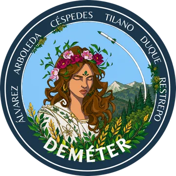
&nbsp;&nbsp;&nbsp;&nbsp;&nbsp;
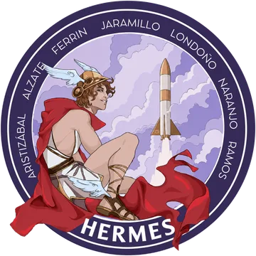

# Deméter & Hermes

**El software completo de los dos cohetes de la Universidad EIA**<br>
Firmware de vuelo · enlace LoRa TDMA · estación terrena · telemetría pública en vivo

**Concurso Colombiano de Cohetería Deportiva 2026 · Categoría 3**<br>
Santa Fe de Antioquia · 8 de noviembre de 2026

[](https://eiaspice.space/)
[](https://github.com/DuqueJR/MCC_Demeter_and_Hermes/tree/v1.0.0)


</div>

<br>

<p align="center">
  <a href="https://eiaspice.space/">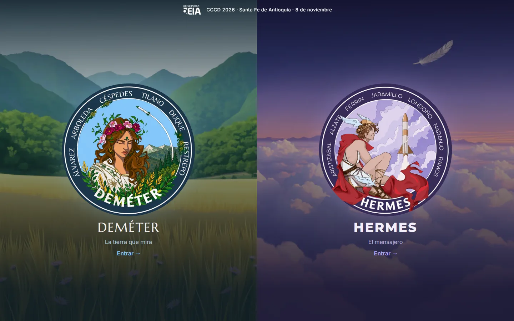</a>
</p>

---

## Tabla de contenido

- [Qué es](#qué-es)
- [Despliegues](#despliegues)
- [Los vuelos del 8 de noviembre](#los-vuelos-del-8-de-noviembre)
- [Recorrido por la web](#recorrido-por-la-web)
- [Arquitectura](#arquitectura)
- [Tecnologías](#tecnologías)
  - [1. Cohete: firmware de vuelo](#1-cohete-firmware-de-vuelo)
  - [2. Enlace LoRa con TDMA](#2-enlace-lora-con-tdma)
  - [3. Estación terrena y dashboard de operación](#3-estación-terrena-y-dashboard-de-operación)
  - [4. Relay público](#4-relay-público)
  - [5. Web pública](#5-web-pública)
  - [6. VisionPack de Deméter](#6-visionpack-de-deméter)
  - [7. Herramientas de análisis](#7-herramientas-de-análisis)
- [Estructura del repositorio](#estructura-del-repositorio)
- [Cómo correrlo](#cómo-correrlo)
- [Pruebas](#pruebas)
- [Cómo se trabajó](#cómo-se-trabajó)
- [Documentación](#documentación)
- [Equipo](#equipo)

---

## Qué es

Un solo sistema de software para **dos cohetes**, cada uno con un CanSat que mide el vuelo y lo cuenta por radio en vivo:

<table>
<tr>
<td width="50%" valign="top" align="center">
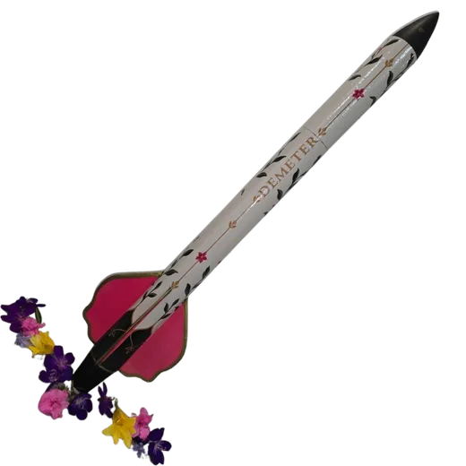<br>
<h3>Deméter · <i>La tierra que mira</i></h3>
Motor <b>H135W-8</b>. Sube con <b>dos cámaras</b> (Raspberry Pi 5 + 2× IMX708) que graban el vuelo, mientras su CanSat transmite la telemetría.
</td>
<td width="50%" valign="top" align="center">
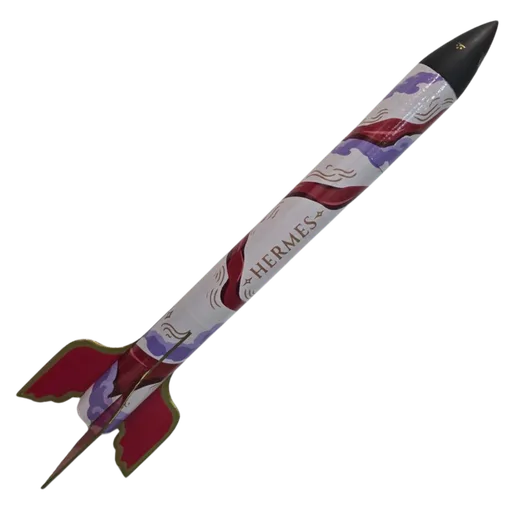<br>
<h3>Hermes · <i>El mensajero</i></h3>
Motor <b>G80-7T</b>. Sube con un CanSat que mide el vuelo y lo cuenta por radio, en vivo, mientras el cohete se eleva.
</td>
</tr>
</table>

El repositorio cubre toda la cadena, de la placa al navegador del público:

| Pieza | Qué hace |
| --- | --- |
| **Firmware de vuelo** | LilyGO T-Beam Supreme (ESP32-S3): sensores principales y de respaldo, EKF de 19 estados a bordo, máquina de estados, registro en la SD y radio |
| **Enlace LoRa** | SX1262 a 903 MHz con TDMA sincronizado por GNSS/PPS: los dos cohetes y la estación comparten el canal sin chocar, a 10 Hz cada cohete |
| **Estación terrena** | T-Beam V1.2 como maestro del TDMA + `dashboard.py`: comandos firmados, descargas, calibración y pestaña EKF |
| **Relay público** | FastAPI en Fly.io: recibe la telemetría de la estación y la difunde por SSE. **Solo lectura**: desde internet no se llega a un cohete |
| **Web pública** | [eiaspice.space](https://eiaspice.space/): una página por misión con mapa 3D, actitud, fuerzas G, gráficas, recuperación con QR y la repetición de los vuelos reales |
| **VisionPack** | El control de la Pi 5 de Deméter: misión, telemetría por UART y el pipeline de captura dual `Eyes of Demeter` |

---

## Despliegues

| Servicio | URL | Plataforma | Se publica desde |
| --- | --- | --- | --- |
| 🌐 **Web pública** | **<https://eiaspice.space/>** (también `web.eiaspice.space`) | Cloudflare Workers (assets estáticos, Workers Builds) | `develop` |
| 🟢 Misión Deméter | <https://eiaspice.space/demeter/> | | |
| 🟣 Misión Hermes | <https://eiaspice.space/hermes/> | | |
| 🛰️ Relay (API) | `https://api.eiaspice.space/api/v1/…` | Fly.io: una máquina en `iad` con volumen persistente | `fly deploy` |

> [!NOTE]
> El sitio se publica desde **`develop`**, que es lo que está en producción. `main` guarda las versiones etiquetadas (`v1.0.0`).
> La guía paso a paso del despliegue (DNS, secretos, verificación) está en [`docs/08_gui/11_guia_despliegue.md`](docs/08_gui/11_guia_despliegue.md).

---

## Los vuelos del 8 de noviembre

Los dos cohetes volaron y aterrizaron con su paracaídas. **🏆 Hermes ganó como mejor cohete** (su objetivo era un apogeo de 400 m y llegó a 393 m).

- **Hermes** detectó el BOOST solo, a los 75 ms del encendido, y su telemetría llegó a tierra a 10 Hz durante todo el vuelo.
- **Deméter** subió con su VisionPack, que grabó el ascenso y el descenso hasta 1 s antes del aterrizaje. La carga de eyección se disparó a los 9,4 s, antes del apogeo, como había predicho la simulación.

Los registros de a bordo se reconstruyeron de forma reproducible ([`tools/vuelo_real/`](tools/vuelo_real/README.md)), y **la web los repite** con el botón *Ver el vuelo real*: cada momento aparece cuando sucedió.

| | **Hermes** (G80-7T) | **Deméter** (H135W-8) |
| --- | :---: | :---: |
| 🏔️ **Apogeo oficial** (altímetro ESTER) | **393,0 m** | **598,0 m** |
| Apogeo físico / EKF | 381,9 / 381,2 m | 586,7 / 586,6 m |
| 🔥 Fin de la combustión | 1,07 s | 1,29 s |
| ⛰️ Apogeo (hecho / anunciado) | 8,78 / 10,01 s | 10,32 / 11,71 s |
| 🪂 Eyección del paracaídas | 9,56 s (después del apogeo) | 9,40 s (antes del apogeo) |
| 🛬 Aterrizaje (hecho / anunciado) | 57,6 / 59,6 s | 81,6 / 83,6 s |

<sub>Tiempos desde el BOOST detectado (el encendido es ~60 ms antes). Detalle y método en <a href="tools/vuelo_real/README.md"><code>tools/vuelo_real/README.md</code></a>.</sub>

<p align="center">
  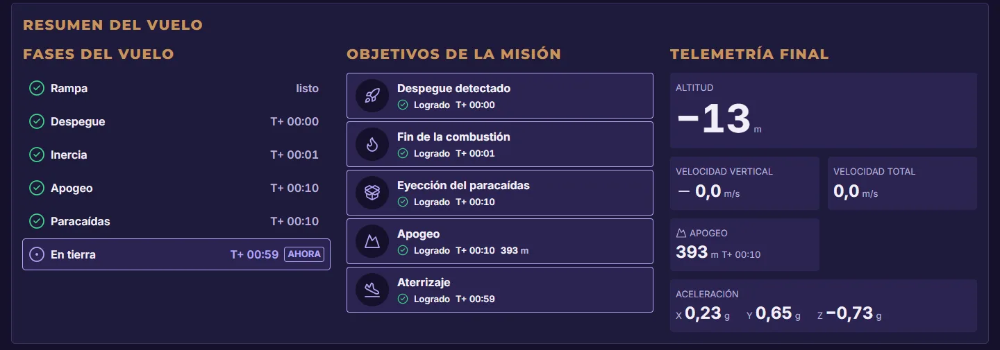
  <br><sub><i>El resumen del vuelo de Hermes en la web: todas las fases y los cinco objetivos logrados.</i></sub>
</p>

<details>
<summary><b>Lo que aprendimos y lo que sigue</b></summary>

<br>

El análisis forense completo está en la [bitácora del 14 de noviembre](docs/07_bitacora/2026-11-14_T-680_forense-y-reconstruccion-vuelos.md). Lo principal quedó como tareas del [backlog](docs/05_plan/backlog.md):

| Tarea | Hallazgo |
| --- | --- |
| T-430 | Pasar a C la detección automática de todos los momentos, ya validada con los dos vuelos |
| T-431 | Revisar el armado forzado por la temperatura del suelo, que dejó a la Pi en espera en cada LAUNCH |
| T-432 · T-433 | El BMP581 de Deméter se congeló y el de Hermes dio lecturas malas a 22 dBm: detectarlo y avisar a tierra |
| T-434 | El QMI8658 quedó bloqueado en ±16 g después del golpe de aterrizaje |
| T-436 | Registrar y transmitir también la altura de referencia del altímetro oficial (ESTER) |
| T-437 | El giro de Hermes en el costeo saturó el LSM6DSO32 (2294 dps) |
| T-438 | Una guía de calibración que mida la cobertura y no deje terminar hasta lograrla |

</details>

---

## Recorrido por la web

### En vuelo

<p align="center">
  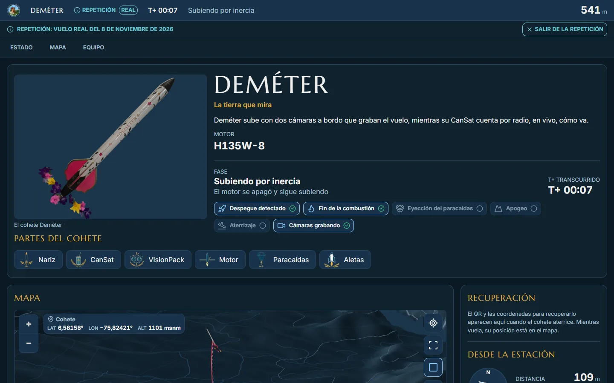
  <br><sub><i>Deméter a T+7 s, subiendo por inercia a 541 m: los objetivos se marcan solos a medida que ocurren.</i></sub>
</p>

<p align="center">
  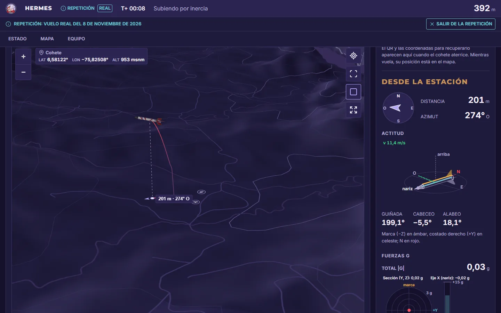
  <br><sub><i>Mapa 3D con relieve y el cohete orientado por su cuaternión. Al lado: distancia y azimut desde la estación, actitud y fuerzas G.</i></sub>
</p>

<table>
<tr>
<td width="68%">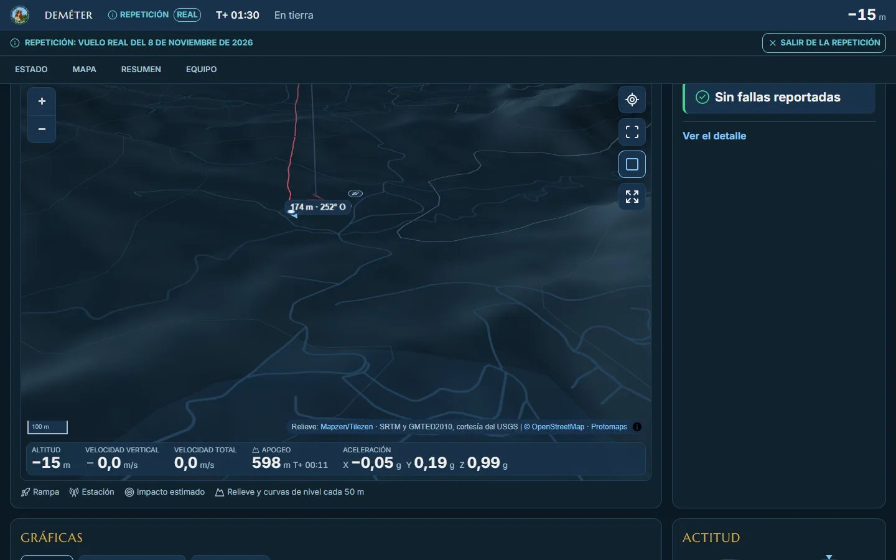<br><sub><i>La trayectoria completa de Deméter (apogeo de 598 m) y el punto de aterrizaje.</i></sub></td>
<td width="32%" align="center">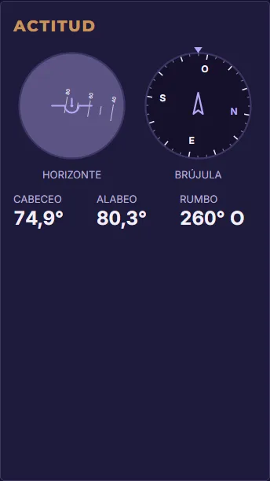<br><sub><i>Horizonte artificial y brújula.</i></sub></td>
</tr>
</table>

### Después del aterrizaje

<p align="center">
  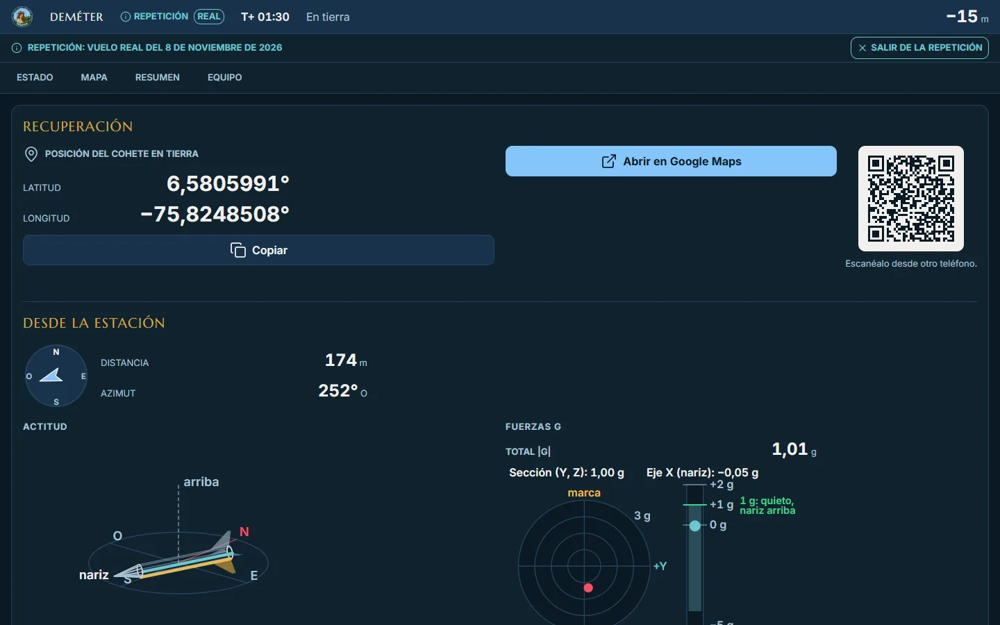
  <br><sub><i>Recuperación: coordenadas para copiar, enlace a Google Maps y un QR para abrirlas desde otro teléfono.</i></sub>
</p>

<table>
<tr>
<td width="62%">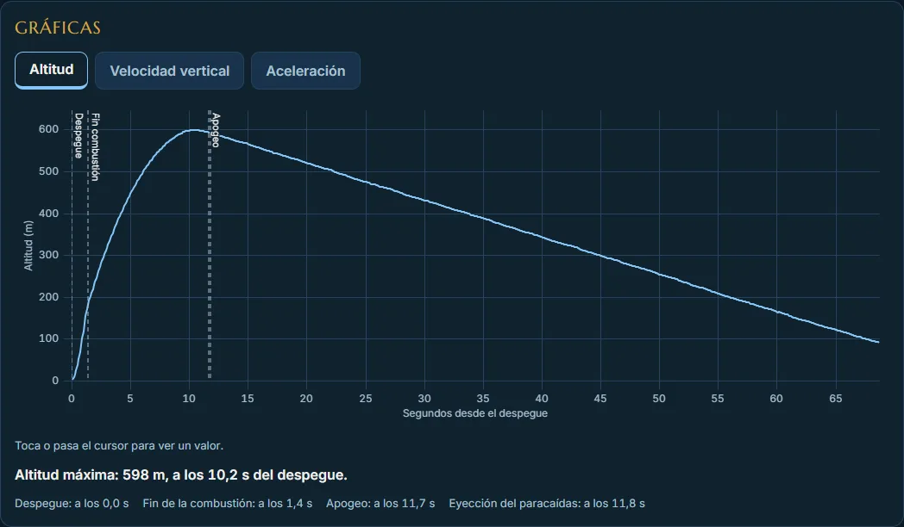<br><sub><i>Gráficas de altitud, velocidad vertical y aceleración, con los momentos del vuelo marcados.</i></sub></td>
<td width="38%" align="center">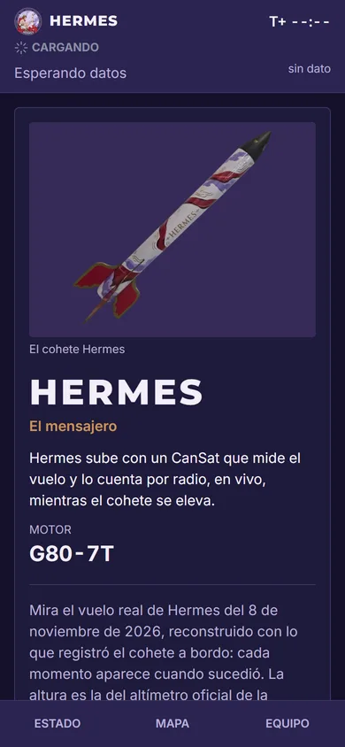<br><sub><i>Pensada primero para el teléfono del público.</i></sub></td>
</tr>
</table>

<p align="center">
  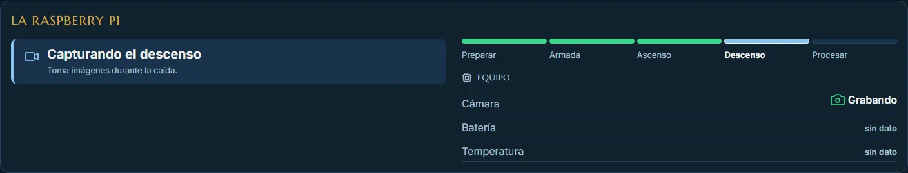
  <br><sub><i>Solo en Deméter: el estado del VisionPack (la Pi 5 y sus cámaras), que llega en la telemetría del CanSat.</i></sub>
</p>

### Dashboard de operación (solo en la estación)

<p align="center">
  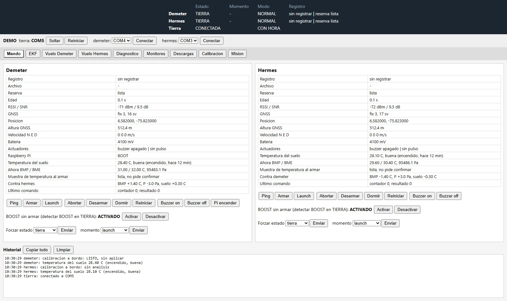
  <br><sub><i><code>estacion/dashboard.py --demo</code>: el tablero de mando de los dos cohetes. Escucha solo en 127.0.0.1.</i></sub>
</p>

---

## Arquitectura

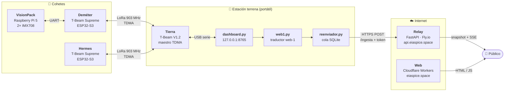

**Los principios del diseño:**

- 🔒 **Ningún comando viene de internet.** El relay solo tiene rutas de lectura hacia afuera. Los comandos salen únicamente del dashboard local, firmados con HMAC-SHA256 y con anti-repetición.
- 🛡️ **La web no puede afectar el vuelo.** El reenviador está apagado por defecto, corre en su propio hilo y tiene cola en disco: si se cae internet, la estación sigue igual y lo atrasado se envía después sin frenar lo nuevo.
- 📜 **Contratos primero.** El protocolo de paquetes, el enlace, la máquina de estados, el formato del log y el contrato `web-1` viven en `docs/04_diseno/` y `docs/08_gui/`. El código los sigue, y un cambio de contrato pasa antes por una decisión registrada.
- 🔢 **Una sola fuente para los números.** Umbrales, tasas, tamaños e IDs salen de [`docs/02_requisitos/constantes.md`](docs/02_requisitos/constantes.md).

---

## Tecnologías

### 1. Cohete: firmware de vuelo

[`firmware/cohete/`](firmware/README.md) · PlatformIO (`espressif32@6.13.0`, framework Arduino) sobre FreeRTOS, unas 10 400 líneas de C++.

**Hardware:** LilyGO **T-Beam Supreme** (ESP32-S3, dos núcleos LX7) con sensores externos y de la placa.

| Función | Sensor principal | Respaldo |
| --- | --- | --- |
| IMU | **LSM6DSO32** (±32 g, ±2000 dps, FIFO a 1,66 kHz) | QMI8658 |
| Barómetro | **BMP581** | BME280 (también temperatura y humedad) |
| Magnetómetro | **MMC5983MA** | QMC6310 |
| GNSS | **u-blox MAX-M10S** a 10 Hz (GPS + Galileo), con **PPS** para la hora | — |
| Radio | **Semtech SX1262** (LoRa) | — |
| Energía y otros | AXP2101 (PMIC), PCF8563 (RTC), microSD, interruptor Hall DRV5032, buzzer | — |

**Tareas FreeRTOS**, fijadas a núcleo: `imu`, `ext_lsm`, `ekf`, `net`, `gnss`, `in_i2c`, `logger`, `mission`, `ext_pi` y `cal`.

**Qué hace:**
- 🧭 **EKF de estado de error con 19 estados** a bordo ([`ekf_core.cpp`](firmware/cohete/src/ekf_core.cpp)): actitud, posición y velocidad NED, sesgos del giro y del acelerómetro, factor de escala y sesgo del barómetro.
- 🚦 **Máquina de estados** `SLEEP → TIERRA → ARMED → FLY → RECOVERY`, con armado en dos pasos y chequeos de aptitud (SD, sensores, fix 3D, batería, quietud y, en Deméter, la Pi lista).
- 🎯 **Momentos del vuelo** dentro de FLY: LAUNCH, BOOST, COAST, APOGEO, CAÍDA, PARACAÍDAS y ATERRIZAJE. El BOOST se detecta solo, por inercia o por presión ([`boost_detect.cpp`](firmware/cohete/src/boost_detect.cpp)). Los demás se marcan desde tierra con `momento <x>`. Su detección automática ya está validada en Python con los dos vuelos reales (`tools/vuelo_real/momentos.py`) y falta pasarla a C (T-430).
- 💾 **Registro binario `rec`** en la SD, con CRC por registro, reserva previa del archivo y descarga por USB ([`formato_log.md`](docs/04_diseno/formato_log.md)).
- 🎛️ **Calibración a bordo** y carga de la calibración por USB (blob binario, D-059).
- 🔌 Encendido de la Pi (IO45) y buzzer de búsqueda tras el aterrizaje.

Envs: `demeter` y `hermes` (banco, 10 dBm), `demeter_campo` y `hermes_campo` (22 dBm, vuelo) y `native` para pruebas en PC.

### 2. Enlace LoRa con TDMA

[`firmware/common/net_proto/`](firmware/common/net_proto/) · contratos: [`enlace_lora_tdma.md`](docs/04_diseno/enlace_lora_tdma.md) y [`protocolo_paquetes.md`](docs/04_diseno/protocolo_paquetes.md).

| Parámetro | Valor |
| --- | --- |
| Radio | **903,0 MHz**, SF7 / BW 500 kHz / CR 4/5, sync word 0xD3 |
| Trama | **25 ranuras de 40 ms por segundo**, alineadas con UTC, con el patrón `T A B A B` |
| Tasa | 2 Hz en tierra y **10 Hz por cohete en vuelo** (TELEM de 64 B, 29,5 ms en el aire) |
| Ocupación | ≈ 60 % del canal con los dos cohetes volando, sin solaparse |
| Hora | PPS del GNSS propio (deriva medida ≈ −53 ppm, fluctuación de 1–2 µs) → baliza firmada de tierra → retención |
| Seguridad | Baliza y comandos con **HMAC-SHA256** truncado a 8 B y contadores anti-repetición guardados en NVS |

Sin una hora válida, el cohete pasa a una *baliza lenta* tipo ALOHA hasta volver a sincronizarse. La estación ([`firmware/tierra/`](firmware/tierra/)) es una **T-Beam V1.2** (ESP32 + SX1262 + NEO-M8N): emite la baliza de hora cada segundo y manda los comandos en sus ranuras.

### 3. Estación terrena y dashboard de operación

[`estacion/`](estacion/README.md) · Python (biblioteca estándar y `pyserial`; `numpy` y `scipy` para el análisis).

| Herramienta | Para qué |
| --- | --- |
| `dashboard.py` + `dashboard.html` | Dueño de los puertos serie: mando de los dos cohetes, diagnóstico, monitores, descargas, calibración, misión y la pestaña **EKF** (actitud 3D, fuerzas G, mapa OSM y línea de tiempo). Modos `--demo` y `--reproducir` |
| `web1.py` | Traduce las líneas de la estación a mensajes del contrato **`web-1`**; también reprocesa sesiones guardadas |
| `reenviador.py` | Sube los `web-1` al relay: hilo propio, cola **SQLite** acotada, lotes idempotentes (`X-Lote-Id`) y prioridad a lo fresco tras un corte |
| `tbget.py` · `tblog.py` | Descargan los `.BIN` del cohete por USB y los resumen o exportan a CSV |
| `calib.py` · `cal_blob.py` | Calibración desde un log guiado y su carga al cohete |
| `ekf.py` | El mismo EKF de 19 estados en PC, para repasar un vuelo |
| `vuelo_sintetico.py` · `vuelos_replay.py` | Vuelos sintéticos desde OpenRocket con el ruido real de los sensores: 24 variantes para validar la detección de momentos |
| `iniciar_sesion.sh` · `reiniciar_relay.sh` | Arrancar la sesión del día y dejar el relay en ceros |

### 4. Relay público

[`gui/relay/`](gui/relay/README.md) · **Python 3.12+ · FastAPI · uvicorn · sse-starlette · jsonschema** · Docker en **Fly.io**.

| Ruta | Quién | Qué |
| --- | --- | --- |
| `POST /api/v1/ingesta` | Solo el reenviador (token Bearer) | Lotes `web-1` validados contra el esquema; deduplica por `X-Lote-Id` |
| `GET /api/v1/{mision}/snapshot` | Público | Último estado, salud, eventos y la serie en columnas (≤ 2000 puntos) |
| `GET /api/v1/{mision}/stream` | Público | **Server-Sent Events**, con reanudación por `Last-Event-ID` y ping cada 15 s |
| `GET /api/v1/salud` | Público | Contadores de salud del servicio |

Un solo proceso con el estado en memoria y los JSONL en un volumen (con `fsync` antes de responder cada lote), límite de streams por IP, CORS cerrado al sitio y sin `/docs` ni OpenAPI expuestos. La máquina nunca se apaga sola: el vuelo no puede perder el SSE.

### 5. Web pública

[`gui/web/`](gui/web/README.md) · **Vite 8 (multipágina) · TypeScript 7 · Preact 11 · `@preact/signals`** · Cloudflare Workers.

| Área | Tecnología |
| --- | --- |
| UI y estado | Preact con signals. Tres entradas aisladas (`/`, `/demeter/`, `/hermes/`): cada misión carga solo lo suyo, y `scripts/aislamiento.mjs` lo verifica en cada build |
| Mapa 3D | **MapLibre GL** + **PMTiles** (Protomaps), con relieve de *Terrain Tiles* (SRTM/GMTED2010) y curvas de nivel calculadas con `d3-contour`. El cohete se dibuja orientado por su cuaternión |
| Gráficas | **uPlot**: altitud, velocidad vertical y aceleración, con los momentos marcados |
| Instrumentos | Actitud 3D, horizonte artificial, brújula, rosa desde la estación y radar de fuerzas G |
| Recuperación | QR generado en el navegador con **uqr** y enlace a Google Maps |
| Datos | Cliente **SSE** con snapshot, costura e interpolación. El contrato `web-1` es un **JSON Schema** validado con **Ajv** |
| Repeticiones | *Ver el vuelo real* (la reconstrucción del 8 de noviembre) y la simulación de OpenRocket, cargadas en diferido y reproducidas solo en el cliente |
| Diseño | Tokens de color por misión (una regla de build prohíbe los colores sueltos), fuentes Inter, Montserrat y Marcellus, imágenes con `vite-imagetools`, favicons y Open Graph por página |
| Calidad | **Biome** (lint y formato), **Vitest** y **Playwright** (390×844 y 1440×900) |

Las ilustraciones (parches, fondos e íconos de las partes del cohete) se generaron con IA (FLUX) y se integraron como assets de cada misión.

### 6. VisionPack de Deméter

[`visionpack/`](visionpack/README.md) · Raspberry Pi 5 (4 GB) + **2× Camera Module 3 (IMX708)** + UPS Geekworm X1200.

- `demeter_missiond.py`, `demeter_telemetryd.py` y `demeter_protocol.py`: el plano de control de la misión y la telemetría por **UART** con el CanSat ([`visionpack_integracion.md`](docs/04_diseno/visionpack_integracion.md)), con un emulador de la LilyGO para probar sin placa.
- [`eyes_of_demeter/`](visionpack/eyes_of_demeter/README.md): pipeline de captura dual en C++ sobre **libcamera** y **libpisp** (RAW `BGGR_PISP_COMP1` y estadísticas del front end), revelado offline con el PiSP Back End, perfiles de exposición y foco y balance de blancos calibrado por cámara.

### 7. Herramientas de análisis

| Carpeta | Qué hace |
| --- | --- |
| [`tools/vuelo_real/`](tools/vuelo_real/README.md) | Reconstrucción **reproducible** de los vuelos reales: recorte verificado con SHA-256, detector de momentos, EKF en PC, altura de referencia ESTER y el guion que reproduce la web |
| [`tools/web_datos/`](tools/web_datos/README.md) | De OpenRocket a JSONL `web-1`: 6 escenarios por misión para desarrollar y probar la web |
| [`datos/`](datos/README.md) | Simulaciones de OpenRocket, logs de referencia y los recortes de los vuelos del 8 de noviembre |

---

## Estructura del repositorio

```text
.
├── firmware/            Firmware de vuelo y de tierra (PlatformIO)
│   ├── cohete/          T-Beam Supreme: envs demeter, hermes, *_campo y native
│   ├── tierra/          T-Beam V1.2: envs tierra y tierra_campo
│   ├── common/          net_proto: paquetes, HMAC, modelo de hora y UBX
│   └── vendor/          Submódulo de LilyGO
├── estacion/            Dashboard de operación, traductor web-1, reenviador y análisis
├── gui/
│   ├── web/             Web pública (Vite + Preact + TypeScript)
│   └── relay/           Relay público (FastAPI, Docker, Fly.io)
├── visionpack/          La Raspberry Pi 5 de Deméter y Eyes of Demeter
├── tools/               vuelo_real y web_datos
├── datos/               Simulaciones de OpenRocket y vuelos reales
├── docs/                Bóveda de Obsidian con toda la documentación
└── scripts/             Atajos de npm para la raíz
```

---

## Cómo correrlo

### Web en local

Necesita **Node 22** y **Python 3** (este último solo para `npm run datos`). Funciona igual en Windows y en macOS, desde la raíz:

```bash
npm run web:instalar                   # una vez: dependencias y Chromium de Playwright
npm run web                            # servidor de desarrollo; abre /dev/ con enlaces a todo
npm run repetidor -- demeter nominal   # relay falso en :8787 con datos de ejemplo
```

Otras órdenes: `web:build`, `web:test`, `web:e2e`, `web:preview`, `datos` y `datos:validar`.

### Relay

```bash
cd gui/relay
python -m venv .venv
.venv/Scripts/python -m pip install -r requirements-dev.txt   # Linux/macOS: .venv/bin/python
cp .env.example .env                                          # y define WEB_INGESTA_TOKEN
.venv/Scripts/python servidor.py                              # 127.0.0.1:8787, el puerto al que apunta Vite
```

En producción, desde la raíz: `fly deploy --config gui/relay/fly.toml --dockerfile gui/relay/Dockerfile`.

### Estación terrena

```bash
pip install pyserial numpy scipy
python estacion/dashboard.py --demo        # sin placas
python estacion/dashboard.py               # con la estación y los cohetes por USB
python estacion/dashboard.py --reproducir sesiones/AAAAMMDD_HHMMSS_tierra.txt --velocidad 4
```

### Firmware

```bash
git submodule update --init firmware/vendor/Lilygo-LoRa-Series
git -C firmware/vendor/Lilygo-LoRa-Series apply --ignore-whitespace ../../common/lilygo_local.patch
cp firmware/common/net_proto/secrets.h.ejemplo firmware/common/net_proto/secrets.h   # y pon la clave real

pio run -d firmware/cohete -e demeter -e hermes
pio run -d firmware/tierra -e tierra
pio run -d firmware/cohete -e demeter_campo -t upload --upload-port <puerto>
```

> [!WARNING]
> Nunca transmitas sin la antena conectada. En el banco usa los envs de banco (10 dBm); solo los `_campo` (22 dBm) son para vuelo.

### Reconstruir los vuelos reales

```bash
python -m tools.vuelo_real              # genera datos/vuelos/20261108/web/ (~20 s)
python -m tools.vuelo_real --validar    # además lo compara con lo versionado
```

---

## Pruebas

| Componente | Herramienta | Orden |
| --- | --- | --- |
| Web: unidad y contrato | Vitest + Ajv | `npm run web:test` |
| Web: extremo a extremo | Playwright (móvil y escritorio) | `npm run web:e2e` |
| Web: aislamiento y colores | Scripts del build | `npm run web:build` |
| Relay | pytest | `cd gui/relay && pytest` |
| Estación (`web1.py`, API local, reenviador) | unittest | `python -m unittest discover -s estacion/pruebas` |
| Vuelos sintéticos (aceptación de T-304) | unittest | `python -m unittest estacion.pruebas.test_vuelos_replay -v` |
| Reconstrucción de los vuelos | unittest | `python -m unittest discover -s tools/vuelo_real/pruebas -t .` |
| Firmware | PlatformIO `native` | `pio test -d firmware/cohete -e native` |
| VisionPack | unittest | `python -m unittest discover -s visionpack -p "test_*.py"` |

---

## Cómo se trabajó

- **Gitflow** con `main` (versiones) y `develop` (lo que está en producción). Una rama `feature/T-xxx-<slug>` por tarea del [backlog](docs/05_plan/backlog.md), cada una en su propio worktree, y PR a `develop` con revisión.
- **Conventional Commits en español** y una entrada de [bitácora](docs/07_bitacora/README.md) por paso: cerca de un centenar.
- **Contratos antes que código:** más de 60 decisiones de diseño registradas en [`decisiones.md`](docs/04_diseno/decisiones.md).
- **Desarrollo asistido por IA:** un Claude principal como documentador, planificador y revisor, y un agente [`desarrollador`](.claude/agents/desarrollador.md) que implementa una tarea por invocación. Para buscar en el repo se usa un grafo de conocimiento con [graphify](https://github.com/Graphify-Labs/graphify).
- El firmware parte del de Pablo Tilano ([ptilanom/DEMETER](https://github.com/ptilanom/DEMETER) @ `17139b2`), importado aquí como fuente única desde el 3 de noviembre de 2026.

---

## Documentación

Toda la documentación vive en [`docs/`](docs/00_INDICE.md), una bóveda de Obsidian. Se empieza por **[`docs/00_INDICE.md`](docs/00_INDICE.md)**.

| Tema | Documentos |
| --- | --- |
| Requisitos | [`constantes.md`](docs/02_requisitos/constantes.md) · [`perfiles_vuelo.md`](docs/02_requisitos/perfiles_vuelo.md) |
| Hardware | [`componentes.md`](docs/03_hardware/componentes.md) · [`buses_y_pines.md`](docs/03_hardware/buses_y_pines.md) |
| Contratos | [paquetes](docs/04_diseno/protocolo_paquetes.md) · [enlace TDMA](docs/04_diseno/enlace_lora_tdma.md) · [máquina de estados](docs/04_diseno/maquina_estados.md) · [log](docs/04_diseno/formato_log.md) · [VisionPack](docs/04_diseno/visionpack_integracion.md) · [`web-1`](docs/08_gui/05_contrato_datos_web.md) |
| Web | [arquitectura](docs/08_gui/04_arquitectura_web.md) · [experiencia y pantallas](docs/08_gui/03_experiencia_y_pantallas.md) · [despliegue](docs/08_gui/11_guia_despliegue.md) |
| Plan | [plan maestro](docs/05_plan/plan_maestro.md) · [backlog](docs/05_plan/backlog.md) · [pruebas](docs/05_plan/plan_pruebas.md) · [riesgos](docs/05_plan/riesgos.md) |

---

## Equipo

<table>
<tr>
<td width="50%" align="center">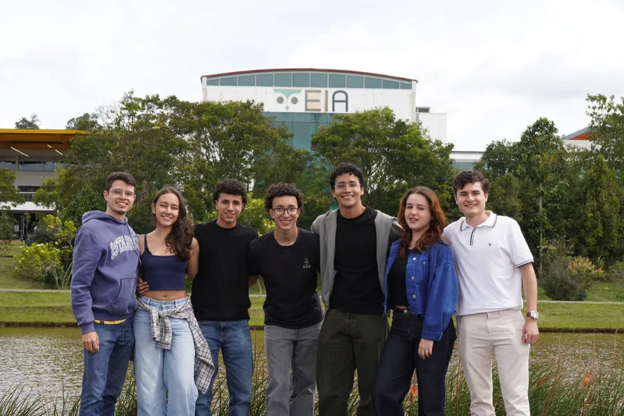<br><b>Deméter</b><br>Álvarez · Arboleda · Céspedes · Tilano · Duque · Restrepo</td>
<td width="50%" align="center">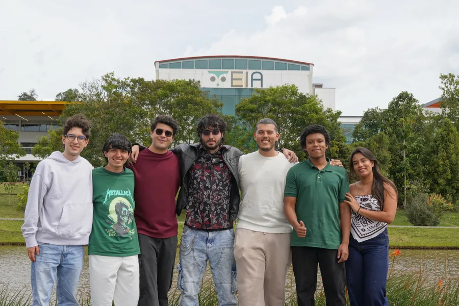<br><b>Hermes</b><br>Aristizábal · Alzate · Ferrin · Jaramillo · Londoño · Naranjo · Ramos</td>
</tr>
</table>

| Rol | Persona |
| --- | --- |
| Software de Hermes | **Juan Pablo Alzate** |
| Software de Deméter | **Jerónimo Duque Ruiz** |
| Firmware base, requisitos de sistemas y revisión | **Pablo Tilano** |

<div align="center">
<br>
<picture>
  <source media="(prefers-color-scheme: dark)" srcset=".github/readme/eia_blanco.webp">
  
</picture>
<br>
<sub><b>Universidad EIA</b> · CCCD 2026 · Santa Fe de Antioquia · 8 de noviembre de 2026</sub><br>
<sub><a href="https://eiaspice.space/">eiaspice.space</a></sub>
</div>
