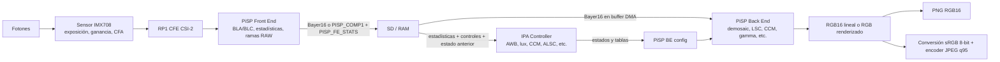

# Demeter Offline ISP: informe de viabilidad y arquitectura

**Estado:** investigación arquitectónica y prototipo funcional validado en hardware (9 de octubre de 2026).  
**Plataforma objetivo:** Raspberry Pi 5 / BCM2712 D0, dos IMX708, libcamera `0.7.2+rpt20260817`, libpisp 1.7.0 según los logs locales.  
**Entrada de misión:** Bayer16 BGGR recuperado de `BGGR_PISP_COMP1`.  
**Salidas:** PNG RGB16 lineal para análisis y JPEG RGB8, sRGB, calidad 95 para fotogrametría.

## Veredicto ejecutivo

La arquitectura más fiel que se puede construir **sin modificar el kernel** es:

1. Durante la captura, guardar por frame el buffer `PISP_FE_STATS` y los controles reales de cámara como sidecar.
2. En tierra, alimentar esos datos y el Bayer16 al **`Controller` C++ original de Raspberry Pi**, aislado de la clase IPA/pipeline handler. El Controller reproduce las decisiones de AWB/CCM/ALSC/contrast/sharpen/denoise y genera estados, no píxeles.
3. Programar el **PiSP Back End** con dichos estados y alimentar su nodo V4L2 de entrada desde Bayer16 en SD. BE sí admite el modelo memory-to-memory y el workspace ya contiene un ejemplo de ejecución de hardware.
4. Codificar sus salidas con software. Mantener una rama lineal sin gamma para PNG16 y otra renderizada para JPEG95.

Esta combinación reutiliza la lógica matemática real del Controller y los bloques PiSP BE, y las estadísticas FE reales capturadas. No reproduce CSI/sensor, exposición ni enfoque, que ya ocurrieron. **No hay una ruta estándar para reproducir el FE desde un archivo bajo el driver Linux actual**: el hardware/configuración tiene campos compatibles con entrada no streaming, pero `rp1_cfe` rechaza ese modo y solo conecta FE a CSI-2. La estrategia FE+IPA+BE offline completa requiere un driver/pipeline personalizado.

### Prototipo mínimo probado

El directorio [offline_isp_prototype](../../offline_isp_prototype/README.md) contiene el capturador de estadísticas FE y el replay del Controller/BE. Se capturó una trama de cámara 0 a 4608x2592: `PISP_FE_STATS` de 23,200 bytes, Bayer `BGGR_PISP_COMP1` y sidecar con exposición/ganancias. El Controller original de libcamera `0.7.2+rpt20260817` se ejecutó aislado del pipeline handler; se excluyeron AGC, AF y sync, que pertenecen al control durante la captura.

El Controller generó AWB 7854 K, CCM finita, ALSC 32x32, CAC de 81 entradas, gamma de 54 puntos y estados DPC/GEQ/SDN/CDN/sharpen. Se tradujeron a la configuración del BE BCM2712 D0; `BackEnd::Prepare()` y el trabajo V4L2 completaron correctamente. La salida RGB888 midió 35,831,808 bytes, min=81, max=169, media=131.80. El resultado demuestra funcionamiento y señal no nula con todos los bloques mapeados; no certifica calidad visual/colorimétrica.

La captura COMP1 declara offset CFE 2048 y el conversor usado para producir Bayer16 aplica offset de descompresión 0. Por eso el replay ajusta el black level de tune 4096 a 2048 antes de BLC; la prueba inicial aplicaba 4096 directamente y saturaba toda la imagen a negro. El offset del descompresor se puede especificar en la CLI. El estado registra ambos niveles para auditar la conversión.

Limitaciones de esta validación: una trama/cámara, misma estadística repetida 64 veces para convergencia asíncrona, salida RGB888 cruda, sin PNG/JPEG ni evaluación visual. Esta repetición permite validar estados y bloques, pero no representa la historia temporal real de una ráfaga.

Para capturas históricas que no tengan estadísticas FE, el Controller aún puede correr con estadísticas aproximadas generadas en software desde Bayer16. El resultado será útil y reproducible, pero el AWB/ALSC/contrast no será exactamente la decisión que tomó la IPA al capturar.

## Fase 0: Flujo completo y bloques

### Lo que ocurre en una captura Raspberry Pi normal

En Pi 5 el bloque de entrada de cámara es **RP1 CFE**, que incluye receptor CSI-2 y PiSP FE. El FE recibe el stream del sensor, hace procesamiento Bayer temprano y escribe una rama RAW y buffers de estadísticas. La rama de imagen se llama `rp1-cfe-fe_image0`; no es la salida del PiSP BE. El pipeline handler PiSP conecta esa salida al nodo `pispbe-input` cuando hay salida de imagen configurada. La IPA recibe estadísticas/configuración y programa FE/BE por buffers V4L2.

Con `rpicam-raw`, la ruta RAW puede ejecutarse sin pedir salida RGB del BE. Aun así, el archivo `BGGR_PISP_COMP1` sale de la rama FE: no debe tratarse automáticamente como el flujo ADC inalterado del sensor. En la configuración PiSP de libcamera, el black-level algorithm entrega `BLA`/`BLC` al FE y también configura BLC de BE. Por tanto, hay riesgo real de volver a restar black level al revelar el Bayer16 ya descomprimido. Hay que verificarlo con los datos de captura y con un dark frame; no asumir que 4096 sigue presente en cada píxel guardado.

El pipeline de captura también usa los controles reales del sensor, `CameraMode`, buffers previos y el orden de frames. `Controller` es una parte de ese flujo, no un revelador autónomo de píxeles.

### IPA frente a PiSP FE/BE

| Algoritmo / bloque | Cálculo de la IPA (software) | Aplicación en hardware PiSP | Consecuencia offline |
|---|---|---|---|
| `rpi.black_level` | Lee niveles estáticos del tune; los publica como estado por frame. | `IpaPiSP` programa BLA/BLC del FE y BLC del BE. | El Bayer guardado puede venir ya corregido por FE. Verificar antes de sustraer black otra vez. |
| `rpi.awb` | Filtra zonas válidas, busca gains/CT según curva, priors por lux y modo, y suaviza la convergencia. | PiSP BE aplica WBG; FE recibe configuración RGBY para estadísticas de luminancia. | Necesita sumas R/G/B por zona y lux para recrear la decisión. El RGB final es otra operación. |
| `rpi.ccm` | Interpola linealmente matrices por CT; puede modificar saturación según lux/control. | PiSP BE CCM después de demosaic. | La matriz es reproducible; falta el CT/lux si no se guardaron o recalcularon. |
| `rpi.alsc` | Interpola calibraciones espaciales Cr/Cb por CT, evalúa estadísticas de color regionales y resuelve mapas lambda iterativamente; filtra resultados entre frames. | PiSP BE LSC, con LUT remuestreados y empaquetados a la geometría del hardware. | La calibración estática se reutiliza; la parte adaptativa necesita zonas AWB, CT, geometría/crop y estado temporal. |
| `rpi.cac` | Lee LUT `lut_rx/ry/bx/by` y escala cada tabla por `strength`. | PiSP BE CAC corrige desplazamientos cromáticos en Bayer antes del demosaic. | Los parámetros se reutilizan. La aplicación exacta requiere la geometría e interpolación del bloque BE o su equivalente CPU. |
| `rpi.contrast` | Lee `gamma_curve`; aplica CE según cuantiles del histograma y compone LUTs. | PiSP BE Gamma LUT. | La curva base se porta directamente; CE requiere un histograma con definición, rango y posición de pipeline compatibles. |
| `rpi.sharpen` | Convierte `threshold`, `limit`, `strength` y factor de modo en estado. | PiSP BE sharpen, tras demosaic, mediante la ruta interna YCbCr/inversa. | Parámetros fáciles de recuperar; el filtro exacto depende de coeficientes, precisión fija y clipping del hardware. |
| `rpi.noise` + `rpi.denoise` | `noise` escala perfil por ganancia analógica y `CameraMode`; `denoise` transforma desviaciones/strength en estados SDN/CDN/TDN. | PiSP BE SDN/CDN y TDN temporal. | SDN/CDN one-shot son aproximables con noise metadata; TDN exige secuencia de frames, ping-pong de buffers y exposiciones. |
| Demosaic / false colour | La IPA habilita y configura el bloque; no estima los colores interpolados en software. | PiSP BE Bayer demosaic y false-colour correction. | Sin BE se necesita OpenCV/u otro demosaicer; su patrón de detalle no será idéntico al PiSP. |
| Estadísticas | La IPA interpreta estadísticas, no las mide desde el archivo en su `Controller`. | PiSP FE calcula AWB, AGC histogram/zonas, floating regions y CDAF. | Se pueden guardar durante el vuelo. Para históricos se aproximan desde Bayer16. |

Los algoritmos de control no están “pegados a transistores”: AWB Bayes, interpolaciones, LUTs, solución ALSC y selección de parámetros son software matemático. Lo específico del SoC es la operación de imagen FE/BE, los acumuladores y límites de estadísticas, orden/cuanti­zación de etapas, LUT discretas, redondeo/clipping y formato de buffers. Una implementación CPU puede calcular matemáticas equivalentes, pero no garantiza idéntico resultado al hardware.

### Posición de la muestra Bayer16

La configuración estándar de libcamera conecta `CSI2 -> pisp-fe`, habilita salida FE 0 y dirige `rp1-cfe-fe_image0` al usuario. Si el sensor produce packed RAW, FE remapea/desempaqueta a su entrada de procesamiento y puede emitir `PISP_COMP1`; después, la prueba local `praw2rgb.cpp` usa el BE para descomprimirlo a BAYER16, activando explícitamente input/decompress y no las demás etapas del revelado.

Así que el punto de partida offline ya es post-CFE/FE y pre-BE. No requiere volver a comprimir ni pasar por el sensor. Para precisión del nivel negro, revisar `applyBlackLevel()` en `src/ipa/rpi/pisp/pisp.cpp`: programa BLA y BLC en FE; en configuración de captura se habilitan en el FE. El tune IMX708 tiene `black_level: 4096` (comentado por el código de libcamera como 64 en 10 bits escalados a 16), pero el Bayer16 extraído puede haber tenido ese nivel restado ya.

## Fase 1: ¿Puede el PiSP FE calcular estadísticas offline?

**Con el driver RP1/CFE estándar de Linux: no.** El código `pisp_fe_validate_config()` exige `cfg->input.streaming == 1` y explica que el driver no soporta leer la entrada desde memoria. El graph media expone FE como subdevice sink ligado a un CSI2 channel; los nodos `fe_image0/1` y `fe_stats` son de captura, no una entrada video-output para que GStreamer les entregue un fichero. `rp1-cfe-fe-config` entrega configuración, no píxeles. Por ello no basta con `v4l2loopback`, `pispconvert` o un pad GStreamer: no existe un enlace de usuario RAW-file -> FE input en ese driver.

Hay, sin embargo, indicios de capacidad de **entrada memory-reader en la descripción de libpisp/hardware**: `pisp_fe_input_config.streaming`, `pisp_fe_config.input_buffer` con dirección DMA/frame id y `FrontEnd(bool streaming, ...)`; el constructor tiene una ruta no streaming para parámetros AXI. El límite probado es el driver RP1 actual, que valida solo streaming. La posibilidad de usar físicamente ese reader debe confirmarse contra la revisión exacta del datasheet PiSP y probarse con un driver modificado. No presento la ruta hardware como imposible en silicio, sino como no soportada por el V4L2 estándar disponible.

**Qué requeriría un FE offline de verdad**

- Cambiar/crear driver para aceptar input no streaming, importar/registrar DMA-BUF Bayer16, programar dirección/stride/format, mantener config+stats+output queues y completar las interrupciones FE.
- Adaptar media graph y sincronización para que no sea obligatorio arrancar CSI/sensor. Conservar el FE stats output (`V4L2_META_FMT_RPI_FE_STATS`) y configurarlo como en PiSP (`FE_CONFIG`, `FE_STATS`, `FE_IMAGE0`).
- Añadir la capa de aplicación que carga cada frame desde SD a DMA-BUF, sincroniza cachés, da de alta su configuración y guarda la estadística correspondiente. Un programa GStreamer necesitaría igualmente un source/elemento V4L2 capaz de proporcionar buffers DMA y del driver adaptado.

No es un cambio pequeño de configuración: toca kernel/V4L2/media controller. No encontré un nodo FE input estándar ni un helper GStreamer que admita ese replay.

**Fallback por software**

Calcular el AWB grid de 32x32 (`pisp_awb_statistics_zone`: sumas R/G/B y `counted`), AGC histogram de 1024 bins, cuatro floating zones y demás regiones desde Bayer16. Esto alimenta los algoritmos sin sensor y permite rehacer lux/AWB/ALSC/CE en un modo offline. La desviación frente al FE real vendrá de valores tras BLA/BLC y posibles ganancias RGBY, límites alto/bajo AWB, crop/decimation, umbrales de región, normalización y acumulación de enteros. Se puede reducir mucho si el origen y orden de las etapas se portan exactamente, pero no recuperar la cuantización/operación FE bit a bit.

La opción superior para nuevas misiones es capturar el propio buffer `PISP_FE_STATS` durante la adquisición. El FE ya calcula exactamente los datos que la IPA usa; la IPA PiSP también puede exponerlos con su control de salida de estadísticas si la aplicación lo habilita. Hay que guardar por frame el buffer raw de estadísticas o su serialización, asociándolo con frame ID, cámara y Bayer. No requiere correr FE offline.

## Fase 2: Ejecutar `Controller` fuera del pipeline

**Sí, condicionalmente.** `RPiController::Controller` es una clase C++ que `read()` del tune, crea los algoritmos registrados, `initialise()`, `switchMode()`, `process(stats, metadata)` y `prepare(metadata)`. No hace syscalls de sensor ni lee píxeles directamente. Puede aislarse en un ejecutable C++ o wrapper, si se construye contra la misma versión de libcamera y se proporcionan explícitamente sus contextos.

**Entradas que hay que suministrar**

- `StatisticsPtr`: `awbRegions` (sums/counts), `yHist`, `agcRegions`/floating Y zones y, si se mantienen algoritmos que la usen, `focusRegions`, row sums, posiciones/pre/post-WB/LSC y dimensiones por target `pisp`.
- `Metadata`: al menos `device.status` con exposición/ganancia/apertura cuando se desea `rpi.lux` y escalado de ruido; `lux.status` para prior AWB/CCM; `awb.status` inicial/anterior para CCM/ALSC; estado ALSC global para AWB cuando las estadísticas son pre-LSC. Mantener el orden por algoritmo y estado entre frames.
- `CameraMode`: bit depth/tamaño de frame y sensor, crop, scale/binning, `noiseFactor`, transform y sensibilidad. Se necesita `switchMode()` antes de `prepare/process`.
- Secuencia y estado: `framePeriod`, `startupFrames`, IIR/convergencia AWB y ALSC, y frames anteriores si se pretende TDN/HDR. Para un still one-shot se puede inicializar el mismo Controller con estado determinista, pero no es la misma historia de convergencia que una ráfaga live.

**Salidas**

Controller no entrega RGB ni un archivo. Cada algoritmo escribe estados con claves como `awb.status`, `ccm.status`, `alsc.status`, `cac.status`, `contrast.status`, `sharpen.status`, `sdn.status`, `cdn.status`, `tdn.status`, `noise.status` y `lux.status` en `Metadata`. La clase `IpaPiSP` consume esos estados y los traduce a `pisp_*_config`/bits enable con `SetWbg`, `SetLsc`, `SetCac`, `SetGamma`, `SetCcm`, `SetSharpen`, etc. El Back End o una implementación CPU ejecuta la imagen posteriormente.

**Coste de aislar/build**

`Controller` es interno, no una API/ABI estable. `controller.cpp` usa `libcamera::File`, `YamlParser` y `ValueNode` internos; los algoritmos dependen de `Metadata`, `Statistics`, `Histogram`, `RegionStats`, `Pwl`, tipos `libcamera::Size`/`Duration` y del hardware config por `target`. El `meson.build` de `src/ipa/rpi/controller` compila `rpi_ipa_controller` como static library contra `libcamera_private` y `libipa` headers. Hay que compilar dentro del árbol/build de libcamera (o copiar y mantener un fork de piezas internas), enlazar la tabla de `RegisterAlgorithm` completa e incluir las dependencias de parsing. Pybind11 no elimina ese acoplamiento.

Puede usarse solo `Controller` sin `IpaBase` si el host construye `CameraMode`, estadísticas y metadata. Reutilizar `IpaBase` completa añade IPA IPC, `ControlList`, `CamHelper`, sensor controls, embedded metadata, timestamps y delayed controls. Como el usuario no quiere AGC/AF, no se necesita emular esa parte: sí se necesitan los valores observados que sus algoritmos downstream consumen.

## Fase 3: Tune IMX708: parámetros y consumidores

El tune tiene `version: 2.0`, `target: "pisp"`; `Controller::read()` acepta JSON como subconjunto YAML en el esquema `algorithms`. Los consumidores reales están en `src/ipa/rpi/controller/rpi/` y el puente PiSP en `src/ipa/rpi/pisp/pisp.cpp`.

| Tune | Consumidor | Estático / dinámico | Offline |
|---|---|---|---|
| `rpi.black_level` | `black_level.cpp` -> `IpaPiSP::applyBlackLevel` | Valor estático por sensor; salida al FE BLA/BLC y BE BLC. | Revisar si captura BAYER16 ya lo recibió. |
| `rpi.lux` | `lux.cpp` | Referencias estáticas; estima lux con Y de floating AGC stats, exposición, ganancia, apertura y sensibilidad de modo. | Sin controles de frame, prior AWB menos fiel. No es AE: calcula metadata de lux. |
| `rpi.dpc` | `dpc.cpp` -> `applyDPC` | `strength` tune/control; `strength:1`. | BE DPC; opera solo en raw Bayer que entra al BE. |
| `rpi.noise` | `noise.cpp` | Const/slope de tune escalados por sqrt de ganancia analógica y `CameraMode.noiseFactor`. | Requiere gain/mode sidecar para reproducir el perfil. |
| `rpi.geq` | `geq.cpp` -> `applyGeq` | offset/slope estáticos salvo controles. | BE GEQ pre-demosaic. |
| `rpi.denoise` | `denoise.cpp` -> `applySdn/Cdn/Tdn` | Config normal/HDR/night estática; estado cambia para backoff temporal y noise profile. | SDN/CDN one-shot factibles; TDN exige secuencia y buffers previos. |
| `rpi.awb` | `awb.cpp`, `awb_bayes.cpp` -> `applyWBG` | Priors, CT curve, modo/bounds, transverse/sensitivity; resultado depende de stats/lux/estado previo. | Portar el algoritmo exacto requiere zonas FE o aproximación software + lux. |
| `rpi.nn.awb` | AWB NN | Está `enabled:false` en el tune adjunto. | No se carga para este perfil. |
| `rpi.agc` | `agc.cpp` y canales | Dinámico; selecciona exposición/gain desde stats y programa sensor. | Excluir; guardar exposición/gain efectivos que ya eligió en vuelo. |
| `rpi.alsc` | `alsc.cpp` -> `applyLensShading` | Calibraciones Cr/Cb + luminance LUT, sigma/omega/iteraciones; estado adaptativo depende de AWB stats/CT y geometría. | Calibración estática sí; mapa adaptativo necesita stats exactas o reconstruidas. |
| `rpi.contrast` | `contrast.cpp` -> `applyContrast` | `gamma_curve` fija + CE desde histograma; `ce_enable:1`. | Histograma por frame necesario para CE equivalente. |
| `rpi.ccm` | `ccm.cpp` -> `applyCCM` | Matrices por CT; también puede depender de lux/saturation. | Interpolación reproducible con CT; resultado toma efecto en BE RGB CCM. |
| `rpi.sharpen` | `sharpen.cpp` -> `applySharpen` | threshold/limit/strength tune más mode factor/control. | Estado reproducible; aplicar exactamente requiere BE o emular su filtro. |
| `rpi.cac` | `cac.cpp` -> `applyCAC` | LUT rx/ry/bx/by y strength. | Datos disponibles en tune; BE CAC los aplica a los canales Bayer. |
| `rpi.af` | `af.cpp` | Control de lente/estadísticas de foco. | Excluir: foco y posición óptica ya quedaron en la captura. |
| `rpi.hdr`, `rpi.sync` | HDR/sync controller + PiSP | HDR está `Off` salvo control; sync coordina cámaras/frames. | No necesarios para still normal; conservar ID/tiempo de frame si se sincronizan cámaras. |

Parámetros dinámicos no equivalen a implementar AGC/AF. Por ejemplo, el AWB usa `lux.status`; lux se deriva de la exposición/ganancia ya aplicadas y stats. Denoise requiere la ganancia que produjo el sensor. Almacenar esos resultados es suficiente; no ejecutar los controladores de captura.

## Fase 4: Cuatro arquitecturas

Estimaciones de calendario indicativas para un ingeniero familiarizado con Python/Linux y pruebas en Pi 5; incluyen un prototipo validado, no certificación fotogramétrica.

| Estrategia | Complejidad | Fidelidad al original | Tiempo orientativo | Riesgo técnico |
|---|---|---|---|---|
| **1. Port Python + NumPy/OpenCV** | Alta: AWB/ALSC y las convenciones estadísticas no son simples filtros. | Media; alta si se guardan stats/estados y se copian bien, pero filtros/demosaic CPU difieren del PiSP. | 3–6 semanas. | Medio-alto: divergencias numéricas, RAM y mantenimiento de dos implementaciones. |
| **2. Wrapper C++ Controller -> Python** | Media-alta: build/ABI internos, binding y normalización de datos; reutiliza matemática C++ original. | Alta en decisiones del Controller; imagen dependerá de usar BE o un revelador CPU. | 2–4 semanas. | Medio: dependencia de versión libcamera, integración del Controller y el host Python. |
| **3. CLI C++ end-to-end** | Media-alta; menos interfaces, mejor control de buffers y memoria. | Alta: Controller C++ + PiSP BE pueden coincidir con la ruta del Pi en etapas digitales. | 2–5 semanas. | Medio: misma dependencia interna; menor ergonomía para experimentar. |
| **4. Controller + FE + BE offline** | Muy alta: driver CFE personalizado, replay DMA y loop de metadata/IPA. | Máxima posible para stats/BE si se reproduce orden, cuantización y estado; no recupera sensor/CSI/AGC ya ocurrido. | 6–12+ semanas, con incertidumbre de driver. | Alto: driver, media graph, DMA/cache, buffers/IRQ, versiones y depuración de kernel. |

### Evaluación de viabilidad por estrategia

**1. Python port.** Es la mejor herramienta para explorar estadísticas, calibraciones y una ruta sin hardware. No es la forma más eficiente de reproducir el pipeline exacto: hay que replicar curva bayesiana, límites, filtros IIR, LSC solver, histogramas y discretizaciones. OpenCV `demosaicing`, `filter2D`, matrices float y PNG no son intercambiables automáticamente con fixed-point PiSP.

**2. C++ wrapper.** Recomendación para investigación/tuning: compilar `rpi_ipa_controller` con el árbol de libcamera emparejado; exportar una función estrecha que reciba JSON/tune, `CameraMode`, sidecar/stats y estado de secuencia, y devuelva estados IPA serializables. Python organiza lotes/diagnósticos. El C++ reutiliza decisiones exactas; el wrapper no convierte por sí solo la imagen.

**3. C++ CLI.** Recomendación para el proceso de vuelo/tierra una vez estabilizado: C++ puede orquestar Controller, `BackEnd`, buffers DMA y un codificador C/C++ con un proceso y menor memoria/intercopia. En libpisp local, `praw2rgb` ya demuestra el modelo de input file -> buffer V4L2 BE -> output file; su estado actual solo descomprime COMP1, así que falta montar las etapas de revelado.

**4. FE + Controller + BE.** El Controller no exige que exista un sensor si se le fabrican `Statistics`, `CameraMode` y metadata. El BE puede consumir un frame de memoria. La barrera es el FE: el driver de RP1 exige input streaming desde CSI-2. Una bifurcación del driver que utilice el camino FE memory-reader es técnicamente plausible por los buffers de entrada en el ABI/config, pero no la expone V4L2 actual y requiere validar con la especificación/revisión de silicio.

Si se cuenta solo el conjunto de bloques digitales de imagen enumerados (Controller + FE + BE), Strategy 4 podría reutilizar **prácticamente el 100% de ese conjunto** en la misma generación de PiSP. No es 100% del sistema `fotones -> JPEG`: sensor/CSI, exposición/analógico, foco, embedded data y encoder JPEG quedan fuera o se sustituyen. No hay un porcentaje global científicamente defendible porque los bloques no equivalen en costo/impacto ni calidad.

## Fase 5: Metadata a guardar en vuelo

Para fidelidad máxima, evitar JSON decimal masivo por cada sumatoria y guardar un sidecar binario versionado o CBOR/NPY por frame, más un manifest que vincule frame IDs, camera IDs, timestamps y hash de tuning. Las tablas originales ya viven en `imx708.json`; no copiarlas en cada frame.

| Prioridad | Campos propuestos | Motivo |
|---|---|---|
| **Imprescindibles para replay con decisiones IPA fieles** | `frame_id`, `camera_id`, timestamp/orden; versión/hash del tune y libcamera/libpisp; width/height, stride, CFA, bit depth, packing/endian y definición exacta de Bayer16; sensor mode/crop/binning/transform; `ExposureTime`, `AnalogueGain` y `DigitalGain` efectivos; buffer `PISP_FE_STATS` por frame o sumas AWB 32x32 + AGC histogram 1024 + floating zones y configuración/crop de stats; estado de black-level/FE (perfil y si BLA/BLC ya aplicaron). | Reproduce entradas de los algoritmos y la posición de etapas. Sin stats se aproximan AWB/ALSC/CE; sin gain no se ajusta noise; black-level evita doble resta. |
| **Muy recomendables** | `Lux`, `ColourTemperature`, `ColourGains`, `ColourCorrectionMatrix`, `SensorBlackLevels` reportados; `FrameDuration`; ruido/NoiseReductionMode; CT/estado ALSC y resultados IPA por frame; cámara/iluminación/calibración y ROI usada. | Sirven como golden status para depurar la reproducción, cubren decisiones derivadas que pueden cambiar entre versiones y soportan análisis científico. Si se recalcula el algoritmo, guardar outputs además permite comparar, no sustituye las entradas. |
| **Opcionales / por investigación** | TDN input/output o frames anteriores; stats CDAF/focus FoM; `LensPosition`; temperatura del sensor; `AWB mode`, metering/constraint/exposure mode y controles manuales; histograma extra/estadísticas de color; CRC/hash del RAW y stats. | TDN requiere secuencia; focus ya se materializó en óptica pero posición ayuda a auditar; temperaturas/controles mejoran trazabilidad. |

**Mínimo práctico de misión:** junto al Bayer16, persistir su formato y origen (post-FE), exposición/gain/digital gain, camera/frame ID, tuning hash y `PISP_FE_STATS`. Si el firmware/app no puede guardar stats, al menos conservar exposición/gain/lux y documentar que stats reconstruidas son aproximadas. Activar/serializar stats necesita una aplicación libcamera adecuada o captar el meta node V4L2 de FE; los logs de `rpicam-raw` hoy muestran `metadata:` vacío y la sesión actual solo cuenta bytes/frames.

## Fase 6: respuestas concluyentes

1. **¿Puede correr el Controller completo fuera de libcamera? — Sí, condicionalmente.** Es reutilizable como C++ interno si se compila con sus dependencias y se suministran `Statistics`, `Metadata`, `CameraMode` y estado temporal. No es API pública estable ni entrega imagen. Excluir AGC/AF es posible seleccionando algoritmos/status necesarios; su información de captura sigue siendo útil.
2. **¿Puede FE generar offline estadísticas desde Bayer16? — No con el driver V4L2 RP1/CFE estándar actual.** El código de driver exige `streaming=1` y rechaza el input-buffer DMA mode. En hardware/ABI hay indicios de ruta memory-reader (`streaming` + `input_buffer`), pero su uso requeriría driver personalizado y validación en Pi 5.
3. **¿Existe arquitectura offline Controller + FE + BE? — Condicional, custom kernel.** No existe una ruta estándar GStreamer/V4L2. El BE ya acepta buffers de memoria; el FE necesitaría rework del driver/media graph. Si durante la misión se guardan stats FE exactas, es innecesario: Controller + BE offline resuelven la mayor parte del valor con menos riesgo.
4. **¿Qué porcentaje reutiliza Strategy 4? — Cerca del 100% de los bloques digitales de ISP enumerados**, bajo misma revisión y replay correcto. El porcentaje del pipeline completo no tiene definición útil: no incluye sensor/CSI ni codificador JPEG y tampoco reconstruye controles ópticos/analógicos de captura.
5. **Veredicto — Strategy 2 para prototipo y Strategy 3 para producción; añadir metadata FE.** Controller C++ original + PiSP BE offline sobre Bayer16 es la mejor mezcla de fidelidad, tiempo y riesgo. Guardar `PISP_FE_STATS` y controles efectivos elimina la principal pérdida de la ruta offline. Strategy 4 solo se justifica si no es posible guardar stats y se requiere reproducir FE exactamente; implica mantenimiento de kernel.

**Ramas RAW de calidad:** la salida `PNG16 ciencia lineal` debe permanecer en RGB lineal y evitar contraste/gamma, sharpening y denoise destructivos; black correction, WB/CCM/ALSC y demosaic siguen siendo transformaciones y deben documentarse. Guardar siempre Bayer16 como dato fuente. Para `JPEG95 fotogrametría`, hacer una rama derivada con tone/contrast/gamma, denoise/sharpen según evaluación, conversión sRGB a 8-bit y encoder JPEG de software. JPEG quality 95 controla cuantización del encoder, no calidad del revelado. PNG16 conserva precisión intermedia, no crea información adicional a la profundidad del sensor.

## Fuentes

- [RP1 CFE / PiSP FE: documentación Linux](https://github.com/raspberrypi/linux/blob/rpi-6.18.y/Documentation/admin-guide/media/raspberrypi-rp1-cfe.rst)
- [RP1 CFE FE driver: `pisp_fe.c`](https://github.com/raspberrypi/linux/blob/rpi-6.18.y/drivers/media/platform/raspberrypi/rp1_cfe/pisp_fe.c)
- [PiSP FE V4L2 stats/config formats](https://github.com/raspberrypi/linux/blob/rpi-6.18.y/Documentation/userspace-api/media/v4l/metafmt-pisp-fe.rst)
- [Linux CFE media driver `cfe.c`](https://github.com/raspberrypi/linux/blob/rpi-6.18.y/drivers/media/platform/raspberrypi/rp1_cfe/cfe.c)
- [PiSP pipeline handler](https://github.com/raspberrypi/libcamera/blob/main/src/libcamera/pipeline/rpi/pisp/pisp.cpp)
- [PiSP IPA hardware mapper](https://github.com/raspberrypi/libcamera/blob/main/src/ipa/rpi/pisp/pisp.cpp)
- [Raspberry Pi Controller](https://github.com/raspberrypi/libcamera/tree/main/src/ipa/rpi/controller)
- [libpisp backend example](../../libpisp/src/examples/praw2rgb.cpp), [backend helper](../../libpisp/src/helpers/backend_device.cpp), [README](../../libpisp/README.md)

**Versión de fuente:** los logs locales reportan libcamera `0.7.2+rpt20260817` y libpisp 1.7.0. Los enlaces de libcamera apuntan a `main`; el driver enlaza `rpi-6.18.y`. Antes de implementar un port exacto, comparar esos archivos con los sources/commit del paquete instalado en la Pi.
